  <picture>
    <source media="(prefers-color-scheme: light)" srcset="assets/banner-light.svg">
    
  </picture>

  
  
  
  

Software engineer with **8+ years** building production systems in banking, consulting and energy. I own features end to end, from requirements and trade-offs to deployment and operations.

At **Chevron** I build the company-wide **data marketplace**, where business units publish, catalogue and govern data products. Before that: an event-driven layer that isolated a legacy database at **Globant**, home-banking microservices for **Banco Galicia** at Accenture, and credit-evaluation systems at **Banco de Venezuela**.

I also build with **LLMs**: a .NET pipeline that reads database schemas and drafts business descriptions for a data catalog, and parallel AI coding agents (Claude Code) that ship features, with human review of every change.

Open to **Senior backend and applied AI engineering roles** (AI engineer, forward deployed engineer) in fintech and product companies, in Buenos Aires (hybrid) or remote.

---

## Now

- **Chevron** — full stack in C# / .NET 10, ASP.NET Core, EF Core, Angular and Azure Functions.
  - Self-service access management for data-science and AI resources, replacing manual grants in Azure.
  - A Durable Functions orchestration that runs the catalog → data-quality → AI-readiness syncs in order, with retries, validated on ~1,500 data-product versions.
  - AI-readiness checks for data products, including lakehouse (Unity Catalog) format checks.
  - The platform's .NET 8 → 10 (~25 projects) and Angular 17 → 21 upgrades, with security fixes.
- **Building with AI** — LLM pipelines in .NET and agent-driven development with Claude Code. Notes in the [digital garden](https://magcdev.github.io/Magcdev.DigitalGarden/).

## Selected work

| Work | What shipped | Stack |
| --- | --- | --- |
| **Chevron data marketplace** | Self-service access management for AI resources; ordered sync orchestration documented in an ADR; AI-readiness checks; Microsoft Graph fixes (paging, 429s) with ~85 regression tests; .NET 10 and Angular 21 upgrades | .NET, Angular, Azure Functions, Service Bus, AI Search, Microsoft Graph |
| **Globant — event-driven decoupling** | Isolated a legacy database behind a producer–consumer layer, so third parties integrate through events, not direct DB access | .NET / C#, Azure Service Bus, Docker, Kubernetes |
| **Accenture × Banco Galicia** | Microservices for one of Argentina's largest home-banking platforms, in a regulated release process | .NET, APIs |
| **Banco de Venezuela — credit** | Credit simulators, customer-behavior databases, and pipelines from transactions into credit-scoring workflows | C#, SQL Server |
| **[entity-description-generator](https://github.com/MagcDEV/entity-description-generator)** (side project) | Scans SQL Server entity schemas and drafts business descriptions with an LLM, as JSON for a data catalog | .NET 10, SQL Server, GitHub Copilot SDK |
| **[BreakRetailManager](https://github.com/MagcDEV/BreakRetailManager)** (side project) | Modular monolith with Clean Architecture, Entra ID auth and an offline-first Blazor WebAssembly PWA | .NET 10, Blazor |
| **[meli-challenge](https://github.com/MagcDEV/meli-challenge)** (side project) | HTTP API for product comparison with field projection, startup validation and a layered, tested design | Go |
| **Independent work** | POS integration with PedidosYa (webhooks, token flow, order-event sequencing) and a modernization plan for a retail inventory and order system | Integrations |

Most of the production work lives in private enterprise repos.

## Experience

| | | |
| --- | --- | --- |
| **2025 – now** | Software Engineer | **Chevron** · Buenos Aires · internal data marketplace |
| **2024 – 2025** | Software Engineer | **Globant** · event-driven isolation; Deloitte engagement platform |
| **2023 – 2024** | Senior .NET Developer | **Accenture** (client: **Banco Galicia**) · home-banking microservices |
| **2023** | Full Stack Developer | **Infosoft CA** · Java / Spring Boot, database to frontend |
| **2022 – 2023** | Software Engineer | **WebCreek** · deployments, runbooks, distributed remote team |
| **2017 – 2021** | Software Developer | **Banco de Venezuela** · credit tooling and SQL Server data layer |

## How I build

  <picture>
    <source media="(prefers-color-scheme: light)" srcset="assets/flow-light.svg">
    
  </picture>

I care about the unglamorous parts of financial and enterprise systems: **idempotency**, **consistency**, **legacy decoupling**, and documentation that another engineer can operate at 2 a.m. With AI features, the same rule applies: every change gets a test and a human review.

## Stack

**Languages** — C#, TypeScript, SQL (T-SQL), Java (Spring Boot), Go (side projects)

**Backend** — .NET / ASP.NET Core, Entity Framework Core, Azure Functions / Durable Functions, microservices, event-driven architecture, REST APIs, Clean Architecture

**AI** — LLM pipelines (GitHub Copilot SDK), AI coding agents (Claude Code), Azure AI Search, AI-readiness assessment of data products

**Cloud & data** — Microsoft Azure (Service Bus, AI Search, API Management, Key Vault), SQL Server / Azure SQL, Microsoft Purview, Microsoft Graph, PostgreSQL

**Delivery & quality** — Azure DevOps, GitHub Actions, SonarQube, SAST, xUnit, Playwright, Docker, Kubernetes, Terraform

**Observability** — Application Insights, Log Analytics (KQL), Datadog

**Frontend** — Angular, Angular Material

**Domains** — banking and fintech (credit, home banking, payments), enterprise data platforms, energy

  
  
  
  
  
  
  
  
  
  

## Notes

Economics coursework at **Universidad Central de Venezuela**. Econometrics and quantitative methods still show up in how I model data and systems.

Spanish native. Fluent English (C2, EF SET certified).

Writing and working notes: [digital garden](https://magcdev.github.io/Magcdev.DigitalGarden/).
