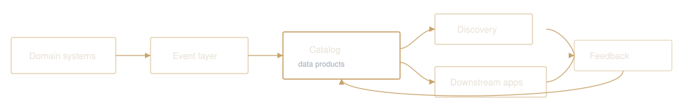

  <picture>
    <source media="(prefers-color-scheme: light)" srcset="assets/banner-light.svg">
    
  </picture>

  
  
  
  

Software engineer with **8+ years** shipping production systems across banking, consulting, and energy. I own features end to end: requirements and trade-off analysis through deployment and operations.

Currently building **Chevron’s internal data marketplace** — the platform that connects data producers and consumers and makes data products discoverable. Before that: home-banking microservices for **Banco Galicia**, an event-driven decoupling layer at **Globant**, and credit-decisioning systems at **Banco de Venezuela**.

Open to **Senior, Lead, or Staff** roles where architectural judgment and delivery ownership matter.

---

## Now

- **Chevron** — backend services in .NET / C#, Go, and Python on Azure for data-product cataloging, discovery, and a feedback loop that helps producers improve quality and consumers find the right datasets.
- **Independent / Break** — POS ↔ PedidosYa integration (webhooks, token flow, order-event sequencing) and a modernization plan for a monolithic inventory/order system.

## Selected work

| Work | What shipped | Stack |
| --- | --- | --- |
| **Chevron data marketplace** | Catalog, rich product descriptions, discovery, and producer/consumer feedback across business units | .NET, Go, Python, Azure |
| **[Entity description generator](https://github.com/MagcDEV/entity-description-generator)** | Scans SQL Server entity schemas and writes AI-backed business descriptions for the catalog | .NET, SQL Server |
| **Globant — event-driven decoupling** | Isolated a legacy database behind a producer–consumer layer so third parties integrate without direct DB access | .NET / C#, messaging |
| **Accenture × Banco Galicia** | Microservices for one of Argentina’s largest home-banking platforms, in a regulated release path | .NET, APIs |
| **Banco de Venezuela — credit** | Credit simulators, customer-behavior databases, and pipelines from transactions into scoring workflows | C#, SQL Server |
| **Break — PedidosYa + architecture** | Partner-portal setup, webhook/order sequencing, and a roadmap off browser-local persistence onto Next.js / Postgres | Integrations, Next.js, Supabase |

Most of the production work lives in private enterprise repos. Public artifacts that match this line of work: [entity-description-generator](https://github.com/MagcDEV/entity-description-generator), [BreakRetailManager](https://github.com/MagcDEV/BreakRetailManager), [meli-challenge](https://github.com/MagcDEV/meli-challenge).

## Experience

| | | |
| --- | --- | --- |
| **2025 – now** | Software Engineer | **Chevron** · Buenos Aires · internal data marketplace |
| **2024 – 2025** | Software Engineer | **Globant** · event-driven isolation; Deloitte engagement platform |
| **2023 – 2024** | Senior .NET Developer | **Accenture** (client: **Banco Galicia**) · home-banking microservices |
| **2023** | Full Stack Developer | **Infosoft CA** · database, API, and frontend, end to end |
| **2022 – 2023** | Software Engineer | **WebCreek** · deployments, runbooks, distributed remote team |
| **2017 – 2021** | Software Developer | **Banco de Venezuela** · credit tooling and SQL Server data layer |

## How I build

  <picture>
    <source media="(prefers-color-scheme: light)" srcset="assets/flow-light.svg">
    
  </picture>

I care about the unglamorous parts of financial and enterprise systems: **idempotency**, **consistency**, **legacy decoupling**, and documentation that another engineer can operate at 2 a.m.

## Stack

**Languages** — C#, Go, SQL (T-SQL), Python, TypeScript / JavaScript

**Backend** — .NET / ASP.NET Core, microservices, event-driven architecture, REST APIs, domain modeling

**Cloud & data** — Microsoft Azure, SQL Server, PostgreSQL / Supabase, CI/CD, deployment automation

**Frontend when needed** — React, Next.js, Angular, Node.js

**Domains** — banking and fintech (credit, home banking, payments), enterprise data platforms, energy

  
  
  
  
  
  
  
  
  
  

## Notes

Economics coursework completed at **Universidad Central de Venezuela** — econometrics and quantitative methods still show up in how I model data and systems.

Spanish native. English at professional working proficiency (EF SET certified).

Writing and working notes: [digital garden](https://magcdev.github.io/Magcdev.DigitalGarden/).
